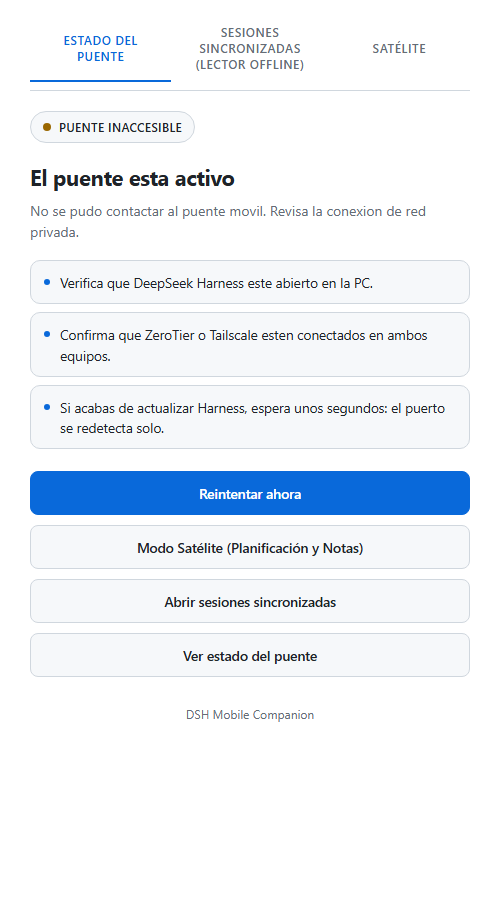

# DSH Mobile Companion

      

> 🌐 **Idiomas / Languages:** [English](README.md) · **[Español (México)](README.es.md)** · [简体中文](README.zh.md) · [日本語](README.ja.md) · [Português (Brasil)](README.pt.md) · [Français](README.fr.md) · [Deutsch](README.de.md)

> 🌐 **Aviso de idioma:** Este documento está traducido para que DSH Mobile Companion sea accesible a desarrolladores internacionales. Las correcciones lingüísticas de la comunidad, las mejoras de redacción y las solicitudes de extracción (pull requests) son muy bienvenidas. El documento de referencia canónico está en [Español (México)](README.es.md).

Acceso móvil a DeepSeek Harness a través de una red privada ZeroTier o Tailscale, sin abrir puertos y sin romper la caché de indicaciones (prompt caching).

La aplicación móvil no reimplementa la interfaz: muestra la propia Web GUI de DeepSeek Harness y le añade una capa táctil. Lo que ves en tu teléfono es el mismo producto que se ejecuta en tu computadora.

Edición endurecida por Ismael Muñoz Reyes para Tinta y Nodos.

Versión actual: **5.1.3** (`versionCode` 43).

---

## Qué resuelve

DeepSeek Harness escucha en `127.0.0.1` y protege sus sesiones con una cookie HMAC derivada de `.credentials.yaml`. Por eso no basta con abrir un puerto ni con usar un túnel genérico: sin esa cookie la interfaz responde 401 y, si se reescribe el origen de la petición sin cuidado, se rompe el prefijo estable que exige la caché de indicaciones.

Este proyecto resuelve los tres problemas a la vez:

- **Firma de sesión transparente.** El puente lee el secreto local, genera la cookie HMAC-SHA256 (versión 1) y la renueva antes de que venza. El navegador móvil nunca ve el secreto.
- **Capa táctil sobre el producto real.** Se inyectan metadatos de viewport, una hoja de estilos y un pequeño script de cliente. La interfaz no se reemplaza: el script solo añade comodidades táctiles (bloque de comandos, teclas de código, sincronización de tema, retransmisión de aprobaciones y de notificaciones). Se ejecuta con el mismo origen y privilegios que la página, así que debe tratarse como parte de la frontera de confianza.
- **Aislamiento de red.** El socket se enlaza exclusivamente a la interfaz de la VPN y solo acepta clientes originados en esa misma red privada.

---

## Arquitectura

```text
Teléfono (red ZeroTier / Tailscale)
        |
        v
bridge.mjs  —enlace exclusivo a la IP de la VPN—
   |-- /                        proxy a DeepSeek Harness + capa táctil
   |-- /offline                 página de espera y lector editorial sin conexión
   |-- /dsh-companion/status    descubrimiento del enlace y verificación de estado
   |-- /dsh-companion/sync      volcado de conversaciones a disco
   |-- /dsh-companion/chats     índice de conversaciones sincronizadas
   |-- /dsh-companion/pc-events Server-Sent Events: "acaba de terminar un turno"
   |-- /dsh-companion/pair-*    emparejamiento y aprobación de dispositivos
        |
        v
127.0.0.1:<puerto de Harness>  DeepSeek Harness
```

Módulos:

```text
companion/
├── bridge.mjs                 arranque, enrutamiento, políticas de socket y de acceso
├── package.json               fuente única de la versión, `npm start` / `npm test`
├── offline.html               estructura de la pantalla de espera
├── offline.css                diseño base, temas y pestañas
├── offline-reader.css         lector editorial y detalle de conversación
├── offline-satellite.css      sección satélite
├── offline-core.js            estado compartido, estado de conexión, navegación
├── offline-reader.js          lector sin conexión, lista, detalle, modos de lectura
├── offline-satellite.js       relevo satélite (envío, fragmentos, finalización)
├── src/
│   ├── config.mjs             configuración y límites centralizados
│   ├── log.mjs                registrador con marca de tiempo
│   ├── network.mjs            descubrimiento de la VPN, autorización, puerto de Harness
│   ├── crypto.mjs             secreto, cookie HMAC v1, clave de acceso, rotación
│   ├── http.mjs               saneamiento de cabeceras, cuerpo acotado, origen confiable
│   ├── routes.mjs             despacho de rutas (estado, datos, control)
│   ├── routes-pairing.mjs     emparejamiento, aprobación, cesión al panel
│   ├── panel.mjs              panel local de aprobación (solo loopback)
│   ├── pairing.mjs            solicitudes pendientes y códigos
│   ├── pairing-views.mjs      HTML del panel
│   ├── devices.mjs            registro de dispositivos, TTL, revocación
│   ├── registry.mjs           registro JSON atómico y seguro ante caídas
│   ├── proxy.mjs              proxy HTTP
│   ├── proxy-ws.mjs           túnel WebSocket
│   ├── mobile.mjs             punto de entrada de la inyección (viewport + script de cliente)
│   ├── mobile-client*.mjs     cliente inyectado, dividido por responsabilidad
│   ├── mobile-styles.mjs      hoja de estilos inyectada
│   ├── pc-events.mjs          observador de turnos de sesión -> notificaciones SSE
│   ├── sync.mjs               persistencia atómica de conversaciones
│   ├── static.mjs             recursos locales con ETag
│   ├── system-stats.mjs       telemetría de CPU, memoria y temperatura
│   ├── qr.mjs / visual-lab.mjs utilidades para los arneses de QR y visual
│   └── ratelimit.mjs          cubo de fichas por cliente
│   ├── device-claim, panel-session, routes-data, sync-format, sync-index, sync-retention
├── android_src/               cliente nativo (Java puro, sin AndroidX)
│   ├── MainActivity.java      ciclo de vida y orquestación
│   ├── CompanionWebViewClient.java, CompanionChromeClient.java
│   ├── CleartextPolicy.java   bloquea el tráfico en claro hacia hosts no privados
│   ├── PcRegistryStore.java, PcEntry.java   registro multipc
│   ├── SettingsScreen.java, HubSheet.java, PcDialogs.java, QrDialogs.java
│   ├── UpdateInstaller.java, KillSwitchUi.java, BiometricGate.java
│   ├── PcEventsService.java   servicio en primer plano para notificaciones de la PC
│   ├── NotificationHelper.java, NotificationChannels.java, NotificationsPc.java
│   ├── KeyStoreVault.java    cifrado con Android Keystore para las claves guardadas
│   └── …                     descubrimiento, telemetría, satélite, WOL, widget
├── test/
│   ├── verify_*.mjs           once suites de verificación (154 comprobaciones)
│   ├── _harness.mjs           cliente compartido
│   └── run-all.mjs            `npm test`
├── tools/
│   └── audit-repo.mjs         auditoría del repositorio (texto, sintaxis, versiones, secretos)
├── build-apk.ps1              construye y firma el APK sin Gradle
├── RELEASING.md               checklist de publicación
├── .github/workflows/verify.yml   CI: sintaxis + auditoría en cada push
├── SECURITY.md                cómo reportar una vulnerabilidad
├── CHANGELOG.md               historial de versiones
└── synced_chats/              conversaciones persistidas (.md y .json)
```

---

## Instalación

### Método 1: configuración automatizada con tu asistente de IA (recomendado)

Si usas un agente de IA o un asistente de programación en tu máquina (DeepSeek Harness, Cursor, Claude Code, Copilot, etc.), pega el siguiente mensaje en tu chat. El asistente clonará el proyecto, configurará el arranque en segundo plano, verificará el puente y te entregará los pasos para conectar el teléfono.

> Guía completa: [AI_SETUP_PROMPT.md](AI_SETUP_PROMPT.md)

```text
Actúa como asistente técnico de configuración en esta máquina.
Tu objetivo es instalar, activar, verificar y configurar por completo "DSH Mobile Companion" (un puente complementario seguro que da acceso móvil a DeepSeek Harness a través de una red privada ZeroTier o Tailscale) y darme instrucciones claras, sin jerga, para conectar mi teléfono.

Sigue estos pasos de forma autónoma y en orden:
1. Verifica "%USERPROFILE%\.dsh" y localiza Node.js (en PATH o en "%USERPROFILE%\.dsh\dsh-runtimes\dsh-primary-runtime\dependencies\node\bin\node.exe").
2. Si aún no estás dentro del directorio, clona: git clone https://github.com/TintaYNodos/dsh-mobile-companion.git
3. Configura el arranque silencioso con "install-autostart.bat" e inicia el servicio con "run-hidden.vbs".
4. Consulta http://127.0.0.1:57420/dsh-companion/status para verificar que el puente responda 200 y reportar el estado de DSH.
5. Entrega un resumen sencillo, sin jerga, con: la URL para mi teléfono (http://<VPN_IP>:57420), el enlace de descarga del APK en GitHub Releases y cómo autorizar mi teléfono desde el panel local.
```

### Método 2: instalación manual

#### Computadora

```bash
git clone https://github.com/TintaYNodos/dsh-mobile-companion.git
```

Node.js 22.15 o más reciente, sin dependencias de npm.

1. Define una clave de acceso (muy recomendado; ver más abajo).
2. Instala el arranque automático con `install-autostart.bat`: registra la tarea silenciosa **y arranca el puente**. No lo inicies otra vez a mano.
3. El puente detecta la interfaz de ZeroTier o Tailscale y se enlaza a ella. Si la detección falla, define `DSH_BIND_HOST` con tu IP privada.

#### Teléfono

Dos métodos equivalentes:

- **Aplicación nativa:** instala `DSH-Companion.apk` desde la sección *Releases*. Selector multipc, reconexión automática, servicio de notificaciones en primer plano y bloqueo biométrico. Alrededor de 210 KB con cero dependencias de terceros: Java puro y reproducible, un icono de recurso y el tema.
- **Sin instalar nada:** abre `http://<VPN_IP>:57420` en tu navegador y elige "Agregar a la pantalla principal".

`/m` responde con una redirección permanente a `/`: el modo satélite anterior se retiró en favor de la interfaz real.

---

## Variables de entorno

| Variable | Valor predeterminado | Efecto |
| --- | --- | --- |
| `DSH_BIND_HOST` | autodetectado | Fuerza la IP privada de enlace |
| `DSH_TARGET_PORT` | autodetectado | Puerto de DeepSeek Harness |
| `DSH_LISTEN_PORT` | `57420` | Puerto de escucha del puente |
| `DSH_PANEL_PORT` | `57421` | Puerto del panel local de aprobación |
| `DSH_HOME` | `%USERPROFILE%\.dsh` | Directorio de credenciales, clave y registro |
| `DSH_BROWSER_SECRET` | — | Secreto proporcionado directamente; omite la lectura del YAML |
| `DSH_ACCESS_KEY` | autogenerada | Clave compartida; anula la clave basada en archivo |
| `DSH_ACCESS_DISABLE` | — | `1` desactiva la clave de acceso, **solo se permite con enlace a loopback** |
| `DSH_COMPANION_TOKEN` | vacío | Token adicional para `/dsh-companion/sync` |
| `DSH_ALLOW_CIDR` | vacío | Subredes adicionales autorizadas, separadas por comas |
| `DSH_DEVICE_TTL_DAYS` | `30` | Vida de la sesión de dispositivo; los dispositivos vencidos se rechazan y se purgan |
| `DSH_DEVICE_REFRESH_HOURS` | `24` | Cada cuánto se renueva la vida al usar el dispositivo |
| `DSH_PENDING_TTL_MIN` | `15` | Minutos que una solicitud de emparejamiento espera aprobación |
| `DSH_ALLOWED_HOSTS` | vacío | Nombres de host extra aceptados en `Host`/`Origin` (MagicDNS de Tailscale) |
| `DSH_ALLOW_GENERIC_VPN` | — | `1` acepta una interfaz tun/tap genérica como red privada |
| `DSH_SYNC_MAX_FILES` | `200` | Número máximo de conversaciones sincronizadas que se conservan |
| `DSH_SYNC_MAX_TOTAL_MB` | `200` | Tamaño máximo de `synced_chats/` en MB |

### Aprobación única desde la computadora

1. Abre la app en tu teléfono: muestra "Confirma en la computadora".
2. En tu PC ejecuta `panel.bat` (o abre la URL que imprime el puente). El panel escucha **estrictamente en 127.0.0.1**.
3. El dispositivo aparece con su código y dirección. Pulsa **Autorizar**.
4. El teléfono se conecta y no volverá a preguntar.

La sesión del dispositivo dura **30 días y se renueva con el uso**: cada vez que se abre la app después de 24 horas, el contador se reinicia. Los dispositivos vencidos ya no se aceptan y se eliminan del registro.

El acceso al panel es un **boleto de un solo uso** que vence y muere al canjearse; a cambio, el navegador recibe una cookie de sesión `HttpOnly`, `SameSite=Strict` cuyo identificador solo existe en memoria. Ningún token viaja en una URL que puedas compartir y no se escribe nada en un archivo con la credencial permanente.

Los dispositivos autorizados viven en `%USERPROFILE%\.dsh\companion-devices.json`. El panel ofrece revocación individual y **Revocar todos**. En el teléfono, el **Interruptor de seguridad** revoca todos los dispositivos, cierra los túneles WebSocket **y rota la clave de acceso**. Detalles en [DISPOSITIVOS.md](DISPOSITIVOS.md).

La clave de acceso manual sigue disponible como respaldo para el acceso desde un navegador estándar, guardada en `%USERPROFILE%\.dsh\companion-access-key`. La app nativa la mantiene cifrada con el Android Keystore.

**Limitación práctica:** HTTP Basic transmite la clave en Base64 sin cifrado de transporte propio. Esto solo es aceptable porque ZeroTier y Tailscale cifran todo el tránsito de extremo a extremo. En una red ZeroTier compartida o pública, un miembro hostil de la red podría intentar una interceptación en capa 2; mantén la red estrictamente privada con autorización manual de nodos.

---

## Rutas

- `GET /` — Web GUI de DeepSeek Harness, con la capa táctil aplicada cuando el cliente es un teléfono.
- `GET /offline` — página de espera mientras Harness arranca, más el lector editorial sin conexión.
- `GET /dsh-companion/status` — `{ service, version, status, dshOnline, targetPort, time }`. Las llamadas anónimas obtienen esta forma mínima; la lista de dispositivos y la telemetría requieren autorización.
- `POST /dsh-companion/sync` — guarda una conversación en `synced_chats/` como Markdown y JSON.
- `GET /dsh-companion/chats` — índice de conversaciones sincronizadas.
- `GET /dsh-companion/chat/:id` — contenido de la conversación (JSON, o Markdown con `?format=md`).
- `GET /dsh-companion/pc-events` — flujo de Server-Sent Events que emite `response-finished` cuando termina un turno en la computadora.
- `POST /dsh-companion/pc-events/test` — emite un evento sintético; lo usa el botón "Probar desde la PC".
- `GET /dsh-companion/pair-state` — punto de sondeo que usa la pantalla de espera.
- `GET /dsh-companion/pair-events` — flujo de aprobación para la pantalla de espera.
- `POST /dsh-companion/open-panel` — abre la ventana del panel local (solo loopback).
- `POST /dsh-companion/retry` — borra un rechazo y solicita acceso de nuevo.
- `POST /dsh-companion/kill-switch` — revoca todos los dispositivos, cierra los túneles y rota la clave de acceso.
- `POST /dsh-companion/action` — retransmisión de aprobaciones de herramientas. Devuelve `501`: las aprobaciones viven en el DOM de la GUI; el puente no las falsifica.
- `GET /dsh-companion/stats` — host telemetry (authorized).
- `POST /dsh-companion/absorb-satellite` — absorbs a satellite-mode note into the conversation.
- `POST /dsh-companion/notification-action` — action from a notification (devices; loopback only).
- `GET /simulator` — mobile interface simulator for development.
- `GET /dsh-companion/stats` — telemetría del host (autorizado).
- `POST /dsh-companion/absorb-satellite` — absorbe una nota del modo satélite en la conversación.
- `POST /dsh-companion/notification-action` — acción desde una notificación (dispositivos; solo loopback).
- `GET /simulator` — simulador de la interfaz móvil para desarrollo.
- `GET /companion.webmanifest` — manifiesto PWA.

---

## Funciones del cliente móvil

- **Bloque de comandos y teclas de código.** Una fila de atajos del redactor y una fila de símbolos de código que aparecen solo mientras el teclado está abierto, debajo de la tarjeta del redactor cuando cabe y encima de ella en caso contrario. Ambas filas se pueden activar o desactivar en Ajustes.
- **Comportamiento de Enter.** Por omisión, Enter inserta un salto de línea; "Enter envía" lo invierte. Implementado contra Lexical con `execCommand`, que es la única escritura que acepta el redactor.
- **Notificaciones de la PC.** Con el servicio en primer plano habilitado, el teléfono recibe una notificación cuando termina un turno en la computadora **incluso con la app cerrada**. El puente vigila el registro de la sesión y se dispara con el registro `turn/end`: exactamente una notificación por turno, sin importar cuánto se detenga el modelo o una herramienta.
- **Canal de notificaciones en primer plano, canal crítico y canal de aprobaciones.** Los avisos críticos (resultado del interruptor de seguridad, acceso revocado) siempre aparecen, omitiendo el filtro de "solo cuando está oculta".
- **Bloqueo biométrico**, selector multipc con QR y captura manual, wake-on-LAN, píldora de telemetría, relevo satélite, widget del sistema.

---

## Modelo de seguridad

**Acceso**

- Clave compartida mediante HTTP Basic en todas las rutas, comparación en tiempo constante y límite de frecuencia por IP.
- Autorización estricta de clientes: loopback, la subred de la interfaz de enlace **con su máscara de red real**, o los CIDR declarados explícitamente.
- La identidad del dispositivo es el **token de la cookie de sesión**, no la IP de origen: un dispositivo que hereda una dirección no hereda la sesión.
- Validación de `Host` contra la dirección del puente (DNS rebinding), rechazo de `Origin: null`, de origen vacío y de `Sec-Fetch-Site` inesperado.
- Rechazo inmediato de `Content-Length` + `Transfer-Encoding` (contrabando de peticiones).
- Las claves de acceso y los tokens de cliente se eliminan antes de pasar por el proxy hacia el backend.
- `DSH_ACCESS_DISABLE=1` se niega a arrancar salvo que el puente esté enlazado a loopback.
- El interruptor de seguridad **rota** la clave de acceso; todo lo que ya estaba emparejado debe aprobarse de nuevo.

**Credenciales**

- El secreto de sesión se lee una sola vez, nunca se registra y nunca se envía al cliente; el proceso falla de inmediato si falta.
- Cookie HMAC-SHA256 versión 1 idéntica a la que emite Harness, con 12 horas de vigencia y renovación anticipada.
- Ante un 401 del backend, el puente recarga el secreto y reintenta una vez, de modo que rotar `.credentials.yaml` no exige reiniciar.
- La clave de acceso nunca se imprime completa en el registro: solo sus últimos cuatro caracteres.
- El panel no tiene token permanente: boleto de un solo uso más cookie de sesión en memoria.
- En Android las claves guardadas se cifran con **AES-256-GCM en el Android Keystore**, con migración automática de los valores antiguos en texto claro.

**Datos y almacenamiento**

- Las conversaciones se escriben de forma atómica, con identificadores saneados y confinamiento estricto de rutas contra el salto de directorio.
- El contenido se escapa antes de serializarse: no se filtra HTML ejecutable a los archivos exportados ni a los índices.
- Límites explícitos de tamaño de cuerpo, cantidad de mensajes y longitud por mensaje.
- Limitación de frecuencia en memoria con un techo acotado.

**Aplicación nativa (Android)**

- `DSH-Companion.apk` — versión **5.1.3**, `versionCode` 43, `minSdk` 26, `targetSdk` 35.
- Sin AndroidX y sin Kotlin: bytecode Java puro, alrededor de 210 KB.
- **Tráfico en claro bloqueado fuera de la red privada**: `CleartextPolicy` rechaza cualquier solicitud que no sea HTTPS o que no apunte al búnker configurado o a una dirección privada/loopback, y la configuración de seguridad de red prohíbe el tráfico en claro hacia los servicios públicos con los que habla la app (GitHub, DeepSeek). Esto se aplica por encima del WebView, porque la configuración de seguridad de red de Android no puede expresar "solo rangos de IP privados".
- Acceso a archivos locales deshabilitado, contenido mixto bloqueado, ventanas emergentes y depuración remota deshabilitadas.
- Acceso al micrófono restringido al origen exacto del búnker (esquema, host y puerto).
- Navegación confinada al origen del búnker; los enlaces externos se delegan al selector del sistema.
- Los errores TLS cancelan la navegación de inmediato.
- `ERR_ABORTED` se distingue de las caídas de transporte, lo que elimina el bucle infinito de recarga.
- `onRenderProcessGone` reconstruye la vista en lugar de dejar que Android cierre la app.
- La reconexión se pausa en segundo plano y aplica retroceso exponencial con jitter.
- Las notificaciones de aprobación se ocultan de la pantalla de bloqueo (`VISIBILITY_SECRET`) y la acción de aprobar se niega a ejecutarse mientras el dispositivo está bloqueado.

---

## Construir el APK

Sin Gradle ni Android Studio: el APK se arma con las herramientas del SDK. Requisitos: **JDK 17+**, Android SDK con la plataforma `android-35` y build-tools, y un keystore (por defecto el de depuración).

```powershell
powershell -ExecutionPolicy Bypass -File build-apk.ps1
```

Lee la versión de `src/config.mjs`, compila `android_src/` con `javac`, pasa por `d8`, inyecta
`classes.dex` y firma con `%USERPROFILE%\.android\debug.keystore` (se puede cambiar con
`-KeyStore`, `-Alias`, `-StorePass`). Detalle en [RELEASING.md](RELEASING.md).

## Pruebas

```bash
npm test
```

Once suites, **154 comprobaciones**, que cubren descubrimiento, inyección móvil, `?dshc=off`, rechazo de origen cruzado, defensas contra contrabando de peticiones, límites de cuerpo, saneamiento de contenido, integridad del handshake WebSocket, seguridad ante corrupción del registro, control de acceso, relevo satélite, TTL del registro de dispositivos, flujo del panel e interruptor de seguridad.

La suite habla con un **puente en vivo** (no es un mock): inicia el puente primero. La ejecución real del interruptor de seguridad es destructiva —revoca dispositivos y rota la clave—, así que se activa de forma opcional con `DSH_TEST_DESTRUCTIVE=1`.

---

> **Modo satélite (opcional):** la página offline puede enviar una conversación a `api.deepseek.com` con la clave de API que configures en el teléfono. Es la única función que sale de tu red privada; es opcional, exige esa clave y desde la 5.1.0 solo puede dispararla el frame principal del búnker.

## Limitaciones honestas

Este diseño está pensado para **uso personal**: un operador, sus dispositivos de confianza y su red privada. No es un servicio multiinquilino.

- El puente concede acceso completo a la sesión de DeepSeek Harness de la cuenta de Windows subyacente. No existe separación de privilegios por dispositivo.
- No hay cuentas de usuario ni RBAC: cualquiera que tenga un dispositivo autorizado controla la sesión.
- El panel de emparejamiento registra la actividad reciente para visibilidad operativa, pero no es un libro de auditoría inmutable y se puede limpiar con un botón.
- Una red ZeroTier pública o compartida anula el perímetro privado. Mantén las redes privadas con autorización manual de nodos en my.zerotier.com.
- Un administrador local en el equipo anfitrión puede inspeccionar credenciales y registros de conversaciones. Ese es el modelo de seguridad de Windows, no un defecto de arquitectura del puente.
- Las conversaciones sincronizadas se guardan en texto claro dentro de `synced_chats/`. En Windows, el modo POSIX `0600` no se traduce en ACL estrictas: la protección efectiva es la ACL del perfil de usuario. Usa BitLocker en equipos compartidos.
- El puente habla HTTP en claro dentro del túnel de la VPN. Eso es correcto mientras ZeroTier o Tailscale cifren el tránsito de extremo a extremo; nunca expongas el puerto del puente fuera de la VPN.
- La configuración de seguridad de red de Android no puede expresar rangos de IP, así que la regla de "solo privado" para el tráfico en claro se aplica en el código de la app (ver `CleartextPolicy`). Un atacante que ya se encuentre dentro de tu VPN todavía puede leer ese tráfico: el cifrado es el túnel.
- La notificación de finalización depende de que DeepSeek Harness escriba el registro `turn/end` en el registro de la sesión. Si una versión futura de Harness cambia ese formato, el aviso deja de llegar (el botón de prueba dentro de la app te dice qué mitad falló).

---

## Estabilidad

**La 5.1.3 es la base congelada de la serie 5.** No recibe funciones nuevas; solo un fallo de seguridad crítico produciría una 5.1.3. Lo siguiente sale como **pre-release** (5.2.0-pre.1 y siguientes) hasta estabilizarse. La rama `stable/5` conserva exactamente este árbol.


## Capturas

| Aplicación | Panel de emparejamiento | Lector offline |
| --- | --- | --- |
|  |  |  |

## Aviso de proyecto comunitario

> **Aviso:** DSH Mobile Companion es un cliente móvil complementario desarrollado por la comunidad para facilitar el acceso remoto seguro a DeepSeek Harness a través de redes privadas (ZeroTier / Tailscale). No es un producto oficial de DeepSeek ni está afiliado, patrocinado o respaldado por DeepSeek. Todas las marcas y logotipos mencionados pertenecen a sus respectivos propietarios.

## Documentos del proyecto

[SECURITY.md](SECURITY.md) · [CONTRIBUTING.md](CONTRIBUTING.md) · [CHANGELOG.md](CHANGELOG.md) · [DISPOSITIVOS.md](DISPOSITIVOS.md) · [RELEASING.md](RELEASING.md) · [AI_SETUP_PROMPT.md](AI_SETUP_PROMPT.md) · [LICENSE](LICENSE)

## Licencia

BSL 1.1 / PolyForm Noncommercial 1.0.0. Gratuito para uso individual, educativo y no comercial. Prohibida la redistribución comercial y la explotación comercial sin autorización expresa.

Autoría y titularidad de derechos: Ismael Muñoz Reyes · Tinta y Nodos. Ver [LICENSE](LICENSE).
