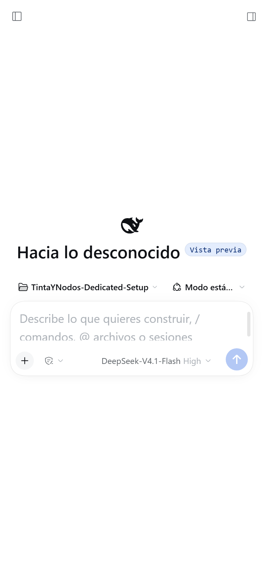
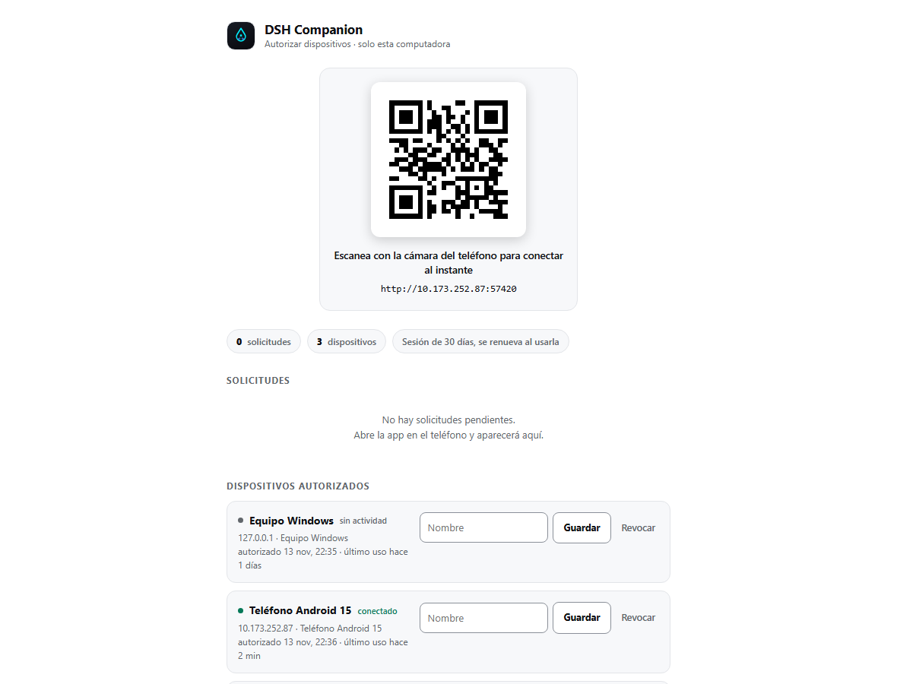

# DSH Mobile Companion

      

> 🌐 **Idiomas / Languages:** [English](README.md) · [Español (México)](README.es.md) · [简体中文](README.zh.md) · **[日本語](README.ja.md)** · [Português (Brasil)](README.pt.md) · [Français](README.fr.md) · [Deutsch](README.de.md)

> 🌐 **言語に関するお知らせ：** 本ドキュメントは、DSH Mobile Companion を世界中の開発者が利用しやすくするために翻訳されたものです。コミュニティによる言語の修正、表現の改善、プルリクエストを心より歓迎します。正式な基準となる文書は[スペイン語（メキシコ）](README.es.md)です。

ZeroTier または Tailscale のプライベートネットワーク経由で DeepSeek Harness にモバイルからアクセスします。ポートを公開する必要はなく、プロンプトキャッシュを壊すこともありません。

モバイルアプリはインターフェースを再実装するものではありません。DeepSeek Harness 自身の Web GUI をそのまま描画し、そこにタッチ用のレイヤーを追加します。スマートフォンに表示されるのは、パソコン上で動作しているのと同じ製品です。

Tinta y Nodos 向けに Ismael Muñoz Reyes が強化したエディションです。

現在のバージョン：**5.1.5**（`versionCode` 45）。

---

## 解決する課題

DeepSeek Harness は `127.0.0.1` で待ち受け、`.credentials.yaml` から導出した HMAC Cookie でセッションを保護しています。そのため、ポートを開放したり汎用のトンネルを使ったりするだけでは不十分です。この Cookie がなければインターフェースは 401 を返し、さらにリクエストのオリジンを雑に書き換えると、プロンプトキャッシュに必要な安定したプレフィックスが壊れてしまいます。

本プロジェクトはこの 3 つの問題を同時に解決します。

- **透過的なセッション署名。** ブリッジがローカルのシークレットを読み取り、HMAC-SHA256 Cookie（バージョン 1）を生成し、有効期限が切れる前に更新します。モバイルブラウザがシークレットを目にすることはありません。
- **実製品の上に載るタッチレイヤー。** viewport メタデータ、スタイルシート、小さなクライアントスクリプトを注入します。インターフェースを置き換えるのではなく、スクリプトはタッチ用の操作性（コマンドドック、コードキー、テーマ同期、承認リレー、通知リレー）を追加するだけです。ページと同じオリジンと同じ権限で動作するため、信頼境界の一部として扱ってください。
- **ネットワーク分離。** ソケットは VPN インターフェースにのみバインドし、同じプライベートネットワークから発信されたクライアントだけを受け付けます。

---

## アーキテクチャ

```text
スマートフォン（ZeroTier / Tailscale ネットワーク）
        |
        v
bridge.mjs  —VPN IP への排他的バインド—
   |-- /                        DeepSeek Harness へのプロキシ + タッチレイヤー
   |-- /offline                 待機ページとオフライン・エディトリアル・リーダー
   |-- /dsh-companion/status    リンク検出とヘルスチェック
   |-- /dsh-companion/sync      会話のディスクへのダンプ
   |-- /dsh-companion/chats     同期済み会話のインデックス
   |-- /dsh-companion/pc-events Server-Sent Events：「ターンが終了しました」
   |-- /dsh-companion/pair-*    デバイスのペアリングと承認
        |
        v
127.0.0.1:<Harness のポート>  DeepSeek Harness
```

モジュール構成：

```text
companion/
├── bridge.mjs                 起動、ルーティング、ソケットおよびアクセス制御ポリシー
├── package.json               バージョンの唯一の情報源、`npm start` / `npm test`
├── offline.html               待機画面のシェル
├── offline.css                基本レイアウト、テーマ、タブ
├── offline-reader.css         エディトリアル・リーダーと会話の詳細
├── offline-satellite.css      サテライト・セクション
├── offline-core.js            共有状態、接続ステータス、ナビゲーション
├── offline-reader.js          オフライン・リーダー、一覧、詳細、閲覧モード
├── offline-satellite.js       サテライトへの受け渡し（送信、チャンク、完了）
├── src/
│   ├── config.mjs             設定と上限値の一元管理
│   ├── log.mjs                タイムスタンプ付きロガー
│   ├── network.mjs            VPN 検出、認可、Harness ポート
│   ├── crypto.mjs             シークレット、HMAC v1 Cookie、アクセスキー、ローテーション
│   ├── http.mjs               ヘッダーのサニタイズ、境界付きボディ、信頼できるオリジン
│   ├── routes.mjs             ルートディスパッチ（状態、データ、制御）
│   ├── routes-pairing.mjs     ペアリング、承認、パネルへの引き渡し
│   ├── panel.mjs              ローカル承認パネル（ループバックのみ）
│   ├── pairing.mjs            保留中のリクエストとコード
│   ├── pairing-views.mjs      パネルの HTML
│   ├── devices.mjs            デバイスレジストリ、TTL、失効
│   ├── registry.mjs           アトミックでクラッシュに強い JSON レジストリ
│   ├── proxy.mjs              HTTP プロキシ
│   ├── proxy-ws.mjs           WebSocket トンネル
│   ├── mobile.mjs             注入エントリ（viewport + クライアントスクリプト）
│   ├── mobile-client*.mjs     注入クライアント（責務ごとに分割）
│   ├── mobile-styles.mjs      注入するスタイルシート
│   ├── pc-events.mjs          セッションのターン監視 -> SSE 通知
│   ├── sync.mjs               会話のアトミックな永続化
│   ├── static.mjs             ETag 付きのローカルアセット
│   ├── system-stats.mjs       CPU、メモリ、温度のテレメトリ
│   ├── qr.mjs / visual-lab.mjs QR とビジュアルハーネス用のヘルパー
│   └── ratelimit.mjs          クライアントごとのトークンバケット
│   ├── device-claim, panel-session, routes-data, sync-format, sync-index, sync-retention
├── tools/
├── audit-repo.mjs   リポジトリ監査（テキスト、構文、バージョン、秘密情報）
├── build-apk.ps1   Gradle なしで APK をビルドして署名
├── doctor.ps1                  インストール診断（Node、トンネル、ブリッジ、パネル）
├── RELEASING.md   リリース手順
├── .github/workflows/verify.yml   CI：push ごとに構文チェックと監査
├── SECURITY.md   脆弱性の報告方法
└── CHANGELOG.md   バージョン履歴
├── android_src/               ネイティブクライアント（ピュア Java、AndroidX なし）
│   ├── MainActivity.java      ライフサイクルとオーケストレーション
│   ├── CompanionWebViewClient.java, CompanionChromeClient.java
│   ├── CleartextPolicy.java   非プライベートホストへのクリアテキストをブロック
│   ├── PcRegistryStore.java, PcEntry.java   マルチ PC レジストリ
│   ├── SettingsScreen.java, HubSheet.java, PcDialogs.java, QrDialogs.java
│   ├── UpdateInstaller.java, KillSwitchUi.java, BiometricGate.java
│   ├── PcEventsService.java   PC 通知用のフォアグラウンドサービス
│   ├── NotificationHelper.java, NotificationChannels.java, NotificationsPc.java
│   ├── KeyStoreVault.java     保存キーの Android Keystore 暗号化
│   └── …                     ディスカバリ、テレメトリ、サテライト、WOL、ウィジェット
├── test/
│   ├── verify_*.mjs           11 個の検証スイート（154 チェック）
│   ├── _harness.mjs           共有クライアント
│   └── run-all.mjs            `npm test`
└── synced_chats/              永続化された会話（.md および .json）
```

---

## インストール

### 方法 1：AI アシスタントを使った自動セットアップ（推奨）

お使いのマシンで AI エージェントやコーディングアシスタント（DeepSeek Harness、Cursor、Claude Code、Copilot など）を利用している場合は、以下のプロンプトをチャットに貼り付けてください。アシスタントがクローン、バックグラウンド起動の設定、ブリッジの検証を代行し、スマートフォンからの接続手順を提示します。

> 詳細ガイド：[AI_SETUP_PROMPT.md](AI_SETUP_PROMPT.md)

```text
あなたはセットアップ担当です。まず診断を実行し、その出力を示してください：

    powershell -ExecutionPolicy Bypass -File doctor.ps1

「トンネルなし」（プライベート IP を持つ ZeroTier/Tailscale インターフェースが無い）と出たら、そこで停止してください。プライベートネットワークが無いとスマートフォンはこの PC に到達できません。ZeroTier（https://my.zerotier.com でネットワーク作成、PC とスマートフォンにクライアント導入、プライベート設定、両ノードを承認）または Tailscale（両方で同じアカウント）の設定方法を説明し、doctor.ps1 を再実行してください。
Node が 22.15 未満なら Node 22 LTS を入れてください。Harness の認証情報が無ければ DeepSeek Harness を開いてログインしてください。ブリッジが停止していれば install-autostart.bat を実行してください。
次に：ブリッジ起動（install-autostart.bat は自動起動を登録し、その場でも起動します。run-hidden.vbs を再度実行しないでください）、panel.bat でスマートフォンをペアリング（パネルにはスマートフォンと同じ 4 桁コードが出ます）、設定 → PC の通知 → PC からテスト で通知を確認します。
最後に doctor.ps1 を再実行し、トンネルのインターフェースと IP、スマートフォンの URL、ブリッジのバージョン、パネル、ペアリング状態、通知テストの結果を報告してください。証拠なしに「動いた」と言わないでください。ブリッジをインターネットに公開せず、アクセスキーを表示せず、指示なくキルスイッチを実行しないでください。
```

### 方法 2：手動インストール

#### パソコン

```bash
git clone https://github.com/TintaYNodos/dsh-mobile-companion.git
```

Node.js 22.15 以降が必要です。npm の依存関係はありません。

1. アクセスキーを設定します（強く推奨。詳細は後述）。
2. `install-autostart.bat` で自動起動をインストールします（Windows ログオン時のサイレントタスク）。
3. ブリッジは ZeroTier または Tailscale のインターフェースを検出し、そこにバインドします。検出に失敗する場合は、`DSH_BIND_HOST` にプライベート IP を設定してください。

#### スマートフォン

2 つの同等な方法があります：

- **ネイティブアプリ：** *Releases* セクションから `DSH-Companion.apk` をインストールします。マルチ PC セレクター、自動再接続、フォアグラウンド通知サービス、生体認証ロックを備えています。サードパーティの依存関係がゼロで、約 210 KB：純粋で再現可能な Java、アセットアイコン、テーマのみです。
- **何もインストールしない方法：** ブラウザで `http://<VPN_IP>:57420` を開き、「ホーム画面に追加」を選択します。

`/m` は `/` への恒久的なリダイレクトを返します。旧式のサテライトモードは廃止され、実際のインターフェースに置き換わりました。

---

停止または自動起動から外すには：`stop.bat`、`uninstall-autostart.bat`（Windows）、`uninstall-launchd.sh`、`uninstall-systemd.sh`（macOS/Linux）。

## 環境変数

| 変数 | デフォルト | 効果 |
| --- | --- | --- |
| `DSH_BIND_HOST` | 自動検出 | プライベートなバインド IP を強制 |
| `DSH_TARGET_PORT` | 自動検出 | DeepSeek Harness のポート |
| `DSH_LISTEN_PORT` | `57420` | ブリッジの待ち受けポート |
| `DSH_PANEL_PORT` | `57421` | ローカル承認パネルのポート |
| `DSH_HOME` | `%USERPROFILE%\.dsh` | 認証情報、キー、レジストリのディレクトリ |
| `DSH_BROWSER_SECRET` | — | シークレットを直接指定し、YAML の読み込みを省略 |
| `DSH_ACCESS_KEY` | 自動生成 | 共有キー。ファイルベースのキーを上書き |
| `DSH_ACCESS_DISABLE` | — | `1` でアクセスキーを無効化。**ループバックにバインドしている場合のみ許可** |
| `DSH_COMPANION_TOKEN` | 空 | `/dsh-companion/sync` 用の追加トークン |
| `DSH_ALLOW_CIDR` | 空 | 追加で許可するサブネット（カンマ区切り） |
| `DSH_DEVICE_TTL_DAYS` | `30` | デバイスセッションの寿命。期限切れのデバイスは拒否され、削除される |
| `DSH_DEVICE_REFRESH_HOURS` | `24` | 使用時に寿命が更新される間隔 |
| `DSH_PENDING_TTL_MIN` | `15` | ペアリング要求が承認を待つ分数 |
| `DSH_ALLOWED_HOSTS` | 空 | `Host`/`Origin` で追加許可するホスト名（Tailscale MagicDNS） |
| `DSH_ALLOW_GENERIC_VPN` | — | `1` で汎用 tun/tap インターフェースを許可 |
| `DSH_SYNC_MAX_FILES` | `200` | 保持する同期会話の最大数 |
| `DSH_SYNC_MAX_TOTAL_MB` | `200` | `synced_chats/` の最大サイズ（MB） |
| `DSH_LOG_MAX_MB` | `5` | ローテーション前の `bridge.log` 最大サイズ（MB、最小 1） |
| `DSH_LOG_KEEP` | `3` | 保持する `bridge.log.N` の数（1–10） |

### パソコンからの初回承認

1. スマートフォンでアプリを開きます。「パソコンで確認してください」と表示されます。
2. パソコンで `panel.bat` を実行します（またはブリッジが表示する URL を開きます）。パネルは**127.0.0.1 でのみ**待ち受けます。
3. デバイスがコードとアドレスとともに表示されます。**承認**を押します。
4. スマートフォンが接続し、以降は確認を求められません。

デバイスセッションは**30 日間有効で、使用するたびに更新**されます。24 時間後にアプリを開くたびにカウンターがリセットされます。期限切れのデバイスは受け付けられなくなり、レジストリから削除されます。

パネルへの入場は**使い捨てチケット**で、有効期限があり、使用すると失効します。その代わりにブラウザは `HttpOnly` かつ `SameSite=Strict` のセッション Cookie を受け取ります。その識別子はメモリ内にのみ存在します。共有できる URL にトークンが流れることはなく、恒久的な認証情報が書かれたファイルも作成されません。

承認済みデバイスは `%USERPROFILE%\.dsh\companion-devices.json` に保存されます。パネルでは個別の失効と**すべて失効**を実行できます。スマートフォン側では、**キルスイッチ**がすべてのデバイスを失効させ、WebSocket トンネルを閉じ、**アクセスキーをローテーション**します。詳細は [DISPOSITIVOS.md](DISPOSITIVOS.md) を参照してください。

手動のアクセスキーは、標準的なブラウザアクセスのフォールバックとして引き続き利用できます。保存先は `%USERPROFILE%\.dsh\companion-access-key` です。ネイティブアプリはこのキーを Android Keystore で暗号化して保持します。

**現実的な制限：** HTTP Basic はキーを Base64 で送信し、それ自体にはトランスポート層の暗号化がありません。これが許容できるのは、ZeroTier と Tailscale がすべての通信をエンドツーエンドで暗号化している場合だけです。共有または公開の ZeroTier ネットワークでは、悪意あるピアがレイヤー 2 での傍受を試みる可能性があります。ネットワークは手動のノード承認によって厳密にプライベートに保ってください。

---

## ルート

- `GET /` — DeepSeek Harness の Web GUI。クライアントがスマートフォンの場合はタッチレイヤーが適用されます。
- `GET /offline` — Harness の起動中に表示される待機ページと、オフライン・エディトリアル・リーダー。
- `GET /dsh-companion/status` — `{ service, version, status, dshOnline, targetPort, time }`。匿名の呼び出し元にはこの最小限の形だけを返します。デバイス一覧とテレメトリには認可が必要です。
- `POST /dsh-companion/sync` — 会話を Markdown と JSON として `synced_chats/` に保存します。
- `GET /dsh-companion/chats` — 同期済み会話のインデックス。
- `GET /dsh-companion/chat/:id` — 会話の内容（JSON、または `?format=md` を付けると Markdown）。
- `GET /dsh-companion/pc-events` — パソコン側でターンが終了したときに `response-finished` を送出する Server-Sent Events ストリーム。
- `POST /dsh-companion/pc-events/test` — 合成イベントを送出します。「PC からテスト」ボタンが使用します。
- `GET /dsh-companion/pair-state` — 待機画面が使用するポーリングエンドポイント。
- `GET /dsh-companion/pair-events` — 待機画面用の承認ストリーム。
- `POST /dsh-companion/open-panel` — ローカルパネルウィンドウを開きます（ループバックのみ）。
- `POST /dsh-companion/retry` — 拒否をクリアし、再度アクセスを要求します。
- `POST /dsh-companion/kill-switch` — すべてのデバイスを失効させ、トンネルを閉じ、アクセスキーをローテーションします。
- `POST /dsh-companion/action` — ツール承認リレー。`501` を返します。承認は GUI の DOM 内にあり、ブリッジがそれを偽装することはありません。
- `GET /companion.webmanifest` — PWA マニフェスト。

---

## モバイルクライアントの機能

- **コマンドドックとコードキー。** コンポーザーのショートカット行と、キーボードが開いている間だけ表示されるコード記号の行。収まる場合はコンポーザーカードの下、収まらない場合は上に表示されます。どちらの行も設定で切り替えられます。
- **Enter キーの動作。** デフォルトでは Enter が改行を挿入し、「Enter で送信」でその動作を反転します。Lexical に対して `execCommand` で実装されており、これがコンポーザーが受け付ける唯一の書き込みです。
- **PC 通知。** フォアグラウンドサービスを有効にすると、パソコン側でターンが終了したときに、**アプリを閉じていても**スマートフォンに通知が届きます。ブリッジはセッションログを監視し、`turn/end` レコードで発火します。モデルやツールがどれだけ長く停止しても、通知はターンごとにちょうど 1 回です。
- **フォアグラウンド通知チャネル、クリティカルチャネル、承認チャネル。** クリティカルな通知（キルスイッチの結果、アクセス失効）は常に表示され、「非表示時のみ」のフィルターを回避します。
- **生体認証ゲート**、QR と手動入力に対応したマルチ PC セレクター、Wake-on-LAN、テレメトリピル、サテライトへの受け渡し、システムウィジェット。

---

## セキュリティモデル

**アクセス**

- すべてのルートで HTTP Basic による共有キー。定数時間比較を行い、IP ごとにレート制限します。
- 厳格なクライアント認可：ループバック、バインドインターフェースのサブネット（**実際のネットマスクを使用**）、または明示的に宣言された CIDR。
- デバイス ID は**セッション Cookie のトークン**であり、送信元 IP ではありません。アドレスを引き継いだデバイスがセッションを引き継ぐことはありません。
- ブリッジのアドレスに対する `Host` 検証（DNS リバインディング）、`Origin: null`、空のオリジン、想定外の `Sec-Fetch-Site` の拒否。
- `Content-Length` と `Transfer-Encoding` の同時指定（リクエストスマグリング）を即座に拒否。
- アクセスキーとクライアントトークンは、バックエンドへプロキシする前に取り除かれます。
- `DSH_ACCESS_DISABLE=1` は、ブリッジがループバックにバインドされていない限り起動を拒否します。
- アクセスキーはキルスイッチによって**ローテーション**され、すでにペアリング済みのものはすべて再承認が必要になります。

**認証情報**

- セッションシークレットは一度だけ読み込まれ、ログにもクライアントにも出ません。見つからない場合はプロセスが即座に失敗します。
- Harness が発行するものと同一の HMAC-SHA256 バージョン 1 Cookie。有効期間は 12 時間で、事前に更新されます。
- バックエンドが 401 を返した場合、ブリッジはシークレットを再読み込みして一度だけ再試行するため、`.credentials.yaml` のローテーションに再起動は不要です。
- アクセスキーがログに完全に出力されることはありません。出力されるのは最後の 4 文字だけです。
- パネルに恒久的なトークンはありません。使い捨てチケットとメモリ内のセッション Cookie だけです。
- Android では、保存されたキーは **Android Keystore 内の AES-256-GCM** で暗号化され、古い平文の値は自動的に移行されます。

**データとストレージ**

- 会話はアトミックに書き込まれ、識別子はサニタイズされ、パストラバーサルに対してパスを厳格に封じ込めます。
- 内容はシリアライズ前にエスケープされ、実行可能な HTML がエクスポートされたファイルやインデックスに漏れ出しません。
- ボディサイズ、メッセージ数、メッセージごとの長さに明示的な上限。
- 上限付きのインメモリ・レート制限。

**ネイティブアプリ（Android）**

- `DSH-Companion.apk` — バージョン **5.1.5**、`versionCode` 45、`minSdk` 26、`targetSdk` 35。
- AndroidX も Kotlin も不使用：純粋な Java バイトコードで約 210 KB。
- **プライベートネットワーク外のクリアテキストをブロック**：`CleartextPolicy` は HTTPS でないリクエスト、または設定済みバンカーやプライベート/ループバックアドレスを指していないリクエストを拒否します。また、ネットワークセキュリティ設定はアプリが通信する公開サービス（GitHub、DeepSeek）へのクリアテキストを禁止します。これは WebView の上層で強制されます。Android のネットワークセキュリティ設定では「プライベート IP 範囲のみ」を表現できないためです。
- ローカルファイルアクセスを無効化、混在コンテンツをブロック、ポップアップとリモートデバッグを無効化。
- マイクへのアクセスはバンカーの正確なオリジン（スキーム、ホスト、ポート）に限定。
- ナビゲーションはバンカーのオリジン内に限定。外部リンクはシステムの選択画面に委ねます。
- TLS エラーは即座にナビゲーションをキャンセル。
- `ERR_ABORTED` はトランスポートの切断と区別され、無限リロードループが解消されます。
- `onRenderProcessGone` は Android にアプリを終了させるのではなく、ビューを再構築します。
- バックグラウンド中は再接続を一時停止し、ジッター付きの指数バックオフを適用します。
- 承認通知はロック画面から隠され（`VISIBILITY_SECRET`）、承認アクションはデバイスがロックされている間は実行を拒否します。

---

## APK のビルド

Gradle も Android Studio も使いません。SDK のビルドツールで APK を組み立てます。必要なもの：JDK 17 以上、`android-35` を含む Android SDK と build-tools、そしてキーストア（既定はデバッグ用）。

```powershell
`powershell -ExecutionPolicy Bypass -File build-apk.ps1`
```


## テスト

```bash
npm test
```

11 個のスイート、**155 のチェック**。ディスカバリ、モバイル注入、`?dshc=off`、クロスオリジン拒否、リクエストスマグリング対策、ボディ上限、コンテンツのサニタイズ、WebSocket ハンドシェイクの完全性、レジストリ破損時の安全性、アクセス制御、サテライトへの受け渡し、デバイスレジストリの TTL、パネルのフロー、キルスイッチをカバーします。

スイートは**稼働中のブリッジ**と通信します（モックではありません）。先にブリッジを起動してください。実際のキルスイッチの実行は破壊的で、デバイスを失効させキーをローテーションするため、`DSH_TEST_DESTRUCTIVE=1` によるオプトインになっています。

---

> **サテライトモード（任意）：** オフラインページは、スマートフォンで設定した API キーを使って会話を `api.deepseek.com` に送信できます。プライベートネットワークの外に出る唯一の機能です。任意で、そのキーが必要で、5.1.0 以降はバンカーのメインフレームからのみ起動できます。

## 正直な制限

この設計は**個人利用**を前提としています。運用者 1 人、その信頼できるデバイス、そのプライベートネットワークです。マルチテナントサービスではありません。

- ブリッジは、基盤となる Windows ユーザーアカウントの DeepSeek Harness セッションへの完全なアクセス権を与えます。デバイスごとの特権分離はありません。
- ユーザーアカウントも RBAC もありません。承認済みデバイスを持つ者がセッションを制御します。
- ペアリングパネルは運用上の可視性のために最近のアクティビティを記録しますが、不変の監査台帳ではなく、ボタン 1 つで消去できます。
- 公開または共有の ZeroTier ネットワークはプライベートな境界を無効にします。my.zerotier.com で手動のノード承認を行い、ネットワークをプライベートに保ってください。
- ホスト上のローカル管理者は認証情報と会話ログを検査できます。これは Windows のセキュリティモデルであり、ブリッジのアーキテクチャ上の欠陥ではありません。
- 同期されたチャットは `synced_chats/` 内に平文で保存されます。Windows では POSIX の `0600` は厳格な ACL に変換されません。実効的な保護はユーザープロファイルの ACL です。共有ハードウェアでは BitLocker を使用してください。
- ブリッジは VPN トンネル内でクリアテキストの HTTP を使用します。ZeroTier または Tailscale が通信をエンドツーエンドで暗号化している間は妥当ですが、ブリッジのポートを VPN の外に公開しないでください。
- Android のネットワークセキュリティ設定は IP 範囲を表現できないため、「プライベートのみ」のクリアテキストルールはアプリのコード（`CleartextPolicy` を参照）で強制されます。すでに VPN の内側にいる攻撃者はその通信を読むことができます。暗号化を担うのはトンネルです。
- 完了通知は、DeepSeek Harness がセッションログに `turn/end` レコードを書き込むことに依存しています。将来の Harness のバージョンがその形式を変更すると、通知は届かなくなります（アプリ内のテストボタンがどちらの半分で失敗したかを示します）。

---

## 安定性

**5.1.5 はシリーズ 5 の固定ベースラインです。** 新機能は追加せず、重大なセキュリティ修正のみ 5.1.5 として出します。以降は **pre-release**（5.2.0-pre.1 など）として提供します。`stable/5` ブランチがこのツリーを保持します。

## スクリーンショット

| アプリ | ペアリングパネル | オフラインリーダー |
| --- | --- | --- |
|  |  |  |

## コミュニティプロジェクトに関するお知らせ

> **お知らせ：** DSH Mobile Companion は、プライベートネットワーク（ZeroTier / Tailscale）経由で DeepSeek Harness への安全なリモートアクセスを容易にするためにコミュニティによって開発されたコンパニオン・モバイルクライアントです。DeepSeek の公式製品ではなく、DeepSeek との提携、後援、推奨関係もありません。記載されているすべての商標およびロゴは、それぞれの所有者に帰属します。

## 商用利用

企業の本番環境での利用、製品やサービスへの組み込み、再配布には別途ライセンスが必要です（Business Source License 1.1）。企業は **Commercial license** フォームから相談できます：[github.com/TintaYNodos/dsh-mobile-companion/issues/new/choose](https://github.com/TintaYNodos/dsh-mobile-companion/issues/new/choose)。詳細は [LICENSING.md](LICENSING.md)。

## ライセンス

Business Source License 1.1 (BUSL-1.1)。個人利用、教育目的、非商業利用は無償です。明示的な許可のない商業的な再頒布および商業的利用は禁止されています。

著作者および著作権：Ismael Muñoz Reyes · Tinta y Nodos。[LICENSE](LICENSE) を参照してください。
